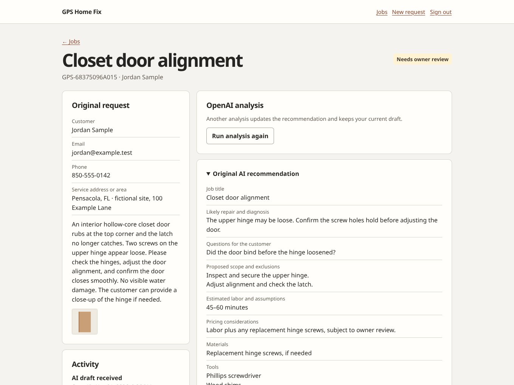
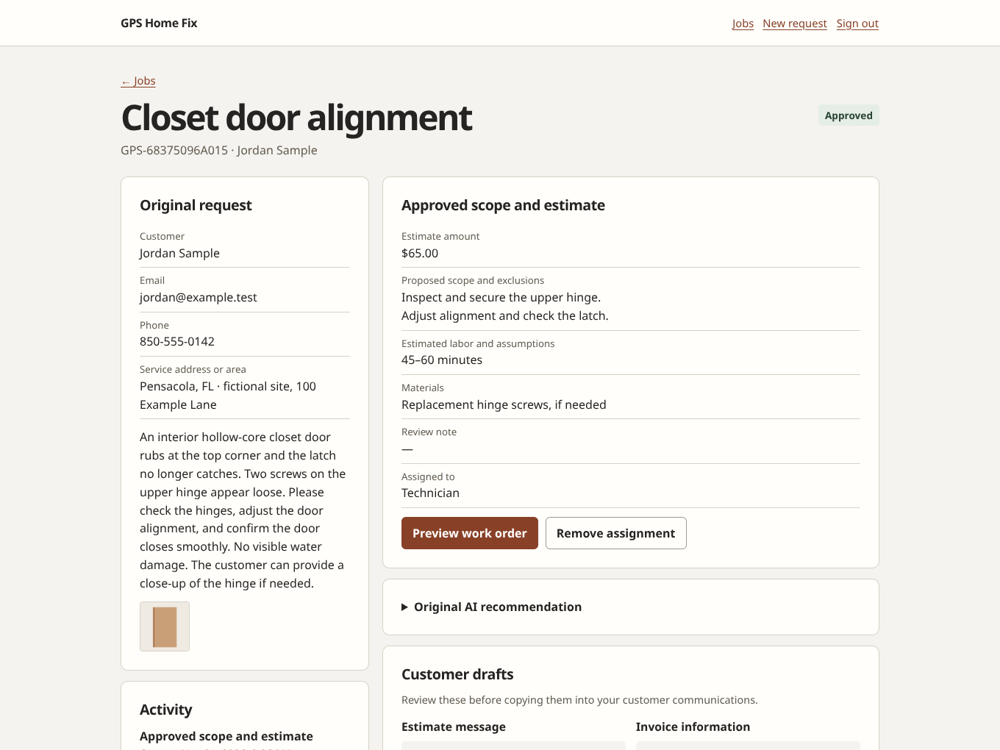
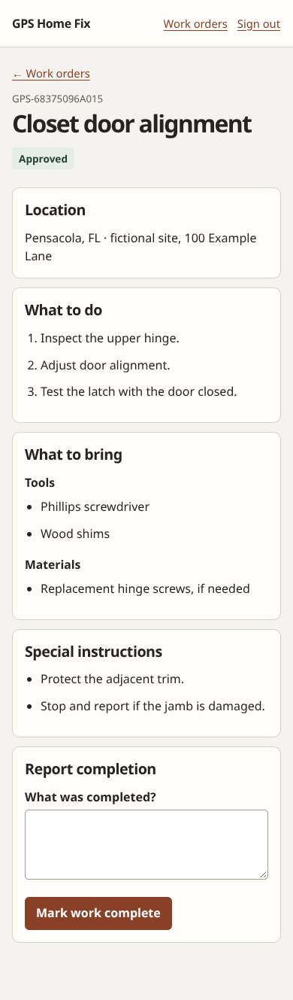
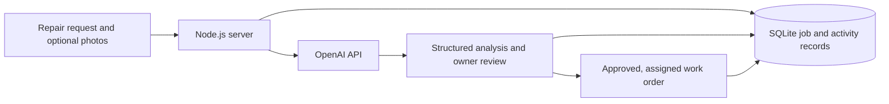

# GPS Home Fix — AI-Assisted Field Service Management

A working Node.js application integrating the OpenAI API into a home-repair business workflow—from analyzing repair requests and photos to preparing estimates, managing approvals, and coordinating technician work orders.

**Core application implemented and tested locally. Production rollout in progress.**

I built GPS Home Fix for Gill Property Services, a family home-repair business in Pensacola, Florida. A request with a description and photos needs to become an estimate I can review and a work order the technician can use on a phone. The application keeps the request, approval, assignment, and work history together.

## Working application

A fictional door repair follows the same workflow as a local job. The AI recommendation shown here came from a simulated OpenAI response.

**Owner job review**



**Approved estimate and assignment**



**Technician work order**



## What the application does

- Saves repair requests with up to three optional JPEG, PNG, or WebP photos. The owner can prepare a draft manually or click **Analyze request** to get a structured recommendation.
- Keeps the original request, AI recommendation, and editable owner draft separately. The owner sets the amount and can save, reject, approve, or assign the job. Rerunning analysis preserves existing owner edits.
- Gives the technician a phone-width work order with the approved tasks, location, tools, materials, and instructions. The technician can report completion. Removing the assignment revokes access through a previously saved work-order link.
- Persists jobs, photo blobs, and activity in SQLite. A utility backs up, verifies, and restores the job database to a new path.

## Architecture



The Node.js server calls the OpenAI Responses API with the repair description and any photos. It requests strict JSON Schema output with `store: false` and validates the response before writing it to SQLite. The structured customer name, email, phone, and location fields stay in the job record. Free-text descriptions and photos are forwarded as entered. Failed analysis leaves the request available for manual review.

## Approval and authorization

Only the owner can open the queue, see intake photos, run analysis, edit prices, and approve or assign work. A technician session can read assigned, approved work orders and record completion. The server checks the role and current assignment on each request. The technician view includes the work location and approved instructions.

Scrypt hashes protect the two local passwords. SQLite stores hashed session tokens and tracks sign-in attempts. Mutating dashboard forms use same-origin and CSRF checks. Job revisions prevent stale form submissions from overwriting updates. A per-job SQLite lock keeps concurrent analysis requests from replacing each other or the owner's edits.

## Verification

| Build | Result |
| --- | --- |
| Original MVP, revision `12ff424` | The original build record reports a successful live OpenAI analysis with a synthetic image. |
| Secured dashboard export, revision `326ea5d` | All six original security and workflow tests passed on Node.js 24.22.3 with mocked OpenAI responses. |
| Curated repository | The same six tests passed on Node.js 24.22.3 with mocked OpenAI responses and synthetic data. A separate live call was outside this review. |

Run the same suite locally or in GitHub Actions.

```sh
node --test tests/check.mjs
```

The suite checks secure startup and role boundaries, throttling and session expiration, intake through completion and assignment revocation, the mocked OpenAI request and concurrency guard, intake gating, and SQLite migration and restore. It creates temporary databases and supplies a fake provider key internally.

## Local setup

Use Node.js **24.22.3** on macOS or Linux. The application and tests use built-in Node.js modules, including `node:sqlite`. There is no dependency installation step.

1. Run `node scripts/generate-login.mjs owner` and `node scripts/generate-login.mjs technician` in a private terminal. The generator provides a different password and hash for each account.
2. Run `(umask 077; cp .env.example .env)` from the repository root. Set the two corresponding password hashes in `.env`. Use your own `OPENAI_API_KEY` and configure `GPS_OPENAI_MODEL` for live analysis, or leave the key blank to use the manual workflow.
3. Run `node --env-file=.env server.mjs` and open `http://127.0.0.1:4321`. Sign in as `owner` and open **New request → Load sample details**. You can attach `tests/synthetic-door.png` to the fictional request.
4. Enter a sample title, scope, labor estimate, work-order tasks, location, and amount. Approve and assign the job. In a separate browser session, sign in as `technician` to view the work order and record completion.

By default, the server binds only to loopback and creates fresh job and session databases under `data/`. Use an absolute `GPS_DB_PATH` to use a different owner-only local directory.

## My role

I defined the workflow around two roles. I needed to review and approve scope and pricing, and the technician needed a clear work order on a phone. I directed the AI-assisted build around that handoff. The engineering checks above document what was tested and how to reproduce the automated suite.

## Production rollout

Production deployment and connection to the public GPS Home Fix website are the next rollout stages. The documented verification applies to the local builds.
