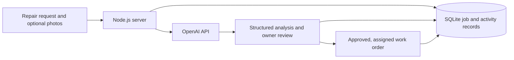

# GPS Home Fix — AI-Assisted Field Service Management

A working Node.js application integrating the OpenAI API into a home-repair business workflow—from analyzing repair requests and photos to preparing estimates, managing approvals, and coordinating technician work orders.

**Core application implemented and tested locally. Production rollout in progress.**

I built GPS Home Fix for Gill Property Services, a family home-repair business in Pensacola, Florida. A request with a description and photos needs to become an estimate I can review and a work order the technician can use on a phone. The application keeps the request, approval, assignment, and work history together.

> **Repository review draft.** The working application described here is documented in the build record. The secured source export, fresh test results, and synthetic screenshots are pending for this review copy.

## What the application does

- Sends repair descriptions and optional photos to the OpenAI API from the Node.js server. The original MVP run verified live analysis with a synthetic image.
- Uses the analysis to help prepare an estimate for owner review. The owner controls approval and assignment.
- Gives the owner access to jobs, photos, estimates, assignments, and activity history.
- Gives the technician a phone-width view of assigned, approved work orders and a way to report completion. The secured-branch walkthrough recorded that removing an assignment revoked access through a previously saved link.
- Uses SQLite for local job and activity records. The secured-branch restore check recorded successful recovery of the job, its photo, the assignment, and the activity history.

## Application screenshots

The proposed captures are the owner’s repair request with simulated analysis and a fictional photo, the estimate approval and assignment screen, and the technician’s assigned work order at phone width. Capture these from the secured build using fictional data.

## Architecture

The API credential belongs on the server. Model output helps prepare the job and estimate. Owner approval and assignment govern the technician handoff. The application stores operational state and history locally so the owner can reconstruct what happened to a request.

## Verification

| Build | Recorded result |
| --- | --- |
| Original MVP, revision `12ff424` | Live OpenAI analysis verified using a synthetic image. |
| Secured dashboard, revision `326ea5d` | Six automated security and workflow tests passed on Node.js 24.22.3 using simulated OpenAI responses. |
| Secured dashboard manual walkthrough | Owner and technician permissions, phone-width technician workflow, assignment removal, and a local restore were checked with synthetic data. |

These results come from the original build records. The curated repository needs a clean run of the six-test suite. The test command and test names will be added from that run.

## Local setup

The secured branch was tested with Node.js 24.22.3. The original MVP was started with `node server.mjs`. The secured branch’s install, start, fixture seed, and test commands will be confirmed from its package files and reproduced in a clean checkout.

For live local analysis, set your own `OPENAI_API_KEY` in the server’s environment using a locally ignored file or your shell. The tracked `.env.example` contains a placeholder. The automated suite uses simulated responses and should run without an API key.

## My role

I defined the business workflow, including what the owner needs to approve and what the technician needs to see to complete a job. The build used AI-assisted code generation. The verified results above describe the application behavior recorded during development. Specific implementation and validation contributions should be confirmed from the build record before publication.

## Production rollout

Production deployment and connection to the public GPS Home Fix website are the next rollout stages. The documented verification applies to the local builds.
